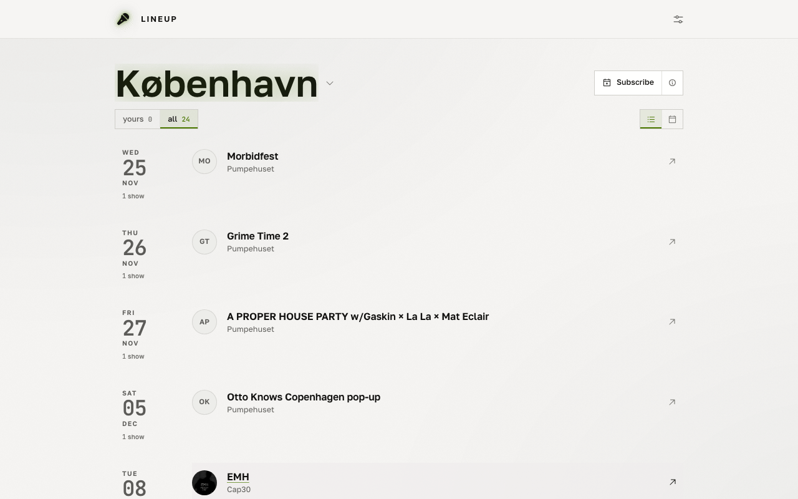

<!-- messer:hero — generated by `python3 ~/Repos/messer-projects/scripts/publish.py --repo . --assets` -->
<picture>
  <source media="(prefers-color-scheme: dark)" srcset="docs/brand/banner-dark.png">
  
</picture>

**A season board for the live scene near you.**

`MIT` · `Go` · `v1.0.0`
<!-- /messer:hero -->

**[lineup.messer.wtf](https://lineup.messer.wtf)** — a season board: what is on in the rooms near a point you
choose, in a date window. No account, no session; the board is public.

The board is complete without a list of your own. Add the acts you go see — pasted, picked from the artists
playing near you, or imported from ListenBrainz — and `yours` appears beside `all`.

## Run

```bash
make build     # bin/lineup
make check     # gofmt + vet + tests + the public-tree scan
./bin/lineup version
```

`lineup mine` walks event platforms country by country and writes the index; `lineup verify` checks the
publication rules before anything leaves the machine; `lineup serve` serves the same index locally, for
self-host. Mining never happens in the board's runtime.

### Self-host

The published instance is one Worker on an edge network. The same board runs from one binary and one
directory, with no account and no database:

```bash
make build web                 # bin/lineup + web/dist (the same-origin build)
./bin/lineup mine --source tickster --town copenhagen,stockholm --index .lineup-index
./bin/lineup serve --index .lineup-index --web web/dist --addr 127.0.0.1:8016
```

Or as a container, which builds both halves and serves them on `:8080`:

```bash
docker build -t messer-lineup .
docker run -p 8080:8080 -v /srv/lineup/index:/data/index messer-lineup
```

The index is a **volume, not a baked asset** — it is a publish artifact that changes nightly. `lineup
serve` reads `LINEUP_INDEX`, `LINEUP_WEB` and `LINEUP_ADDR` from the environment so a container can be
configured with `ENV` alone (a flag still wins). `LASTFM_KEY` is optional and enables only the Last.fm
taste import; without it that route answers `not_configured`, which is a fact about the build rather than
a provider outage. The music policy travels with the binary: `sources/venues/<market>.json`.

## What it does

|  |  |
|---|---|
| **Artists you actually listen to** | imported from a music service, or a list you paste |
| **Rooms near a point you choose** | distance in kilometres on the row, not a map you have to read |
| **A music board** | concerts and music festivals only — theatre, dinner shows and workshops never reach the index |
| **A published season** | the next 120 days, day by day, with the same rows as a month calendar |
| **A calendar you subscribe to** | one link puts this board in Apple or Google Calendar, and it refills nightly |
| **Ticket link** | every row links out to the seller; the board never pretends to sell |
| **No account** | the board is public; the taste is local |

**Subscribing is the part nobody expects.** A season board is not a page you check — it is a calendar. The one
control at the right of the town's name turns *this* board into a `webcal:` feed (the town, the artists you
picked, the genres you picked), and a calendar app polls it forever after. Nothing is copied: the feed renders
from the published index on every fetch, so a subscription that holds nothing today gains dates the night one of
those acts announces, and each row behind it still goes out to the seller. No account, no per-show invites, no
second app — a subscription is a URL that keeps working, and it is the only way to follow an artist you can't
see yet.

<picture>
  <source media="(prefers-color-scheme: dark)" srcset="docs/brand/screen-dark.png">
  
</picture>


## API

The board is served from the same origin as its data. Every route is a `GET`; nothing here needs a key.

| Path | Answers |
|---|---|
| `/index/{manifest.json,towns.json,towns/<town>-<sha256>.jsonl.gz}` | the published index — content-addressed shards, immutable |
| `/api/v1/artists/portraits?n=<names>` | up to eight artist faces, keyed by the name that was sent |
| `/api/v1/artists/search?q=<name>` | MusicBrainz lookups for the artist picker |
| `/api/v1/taste/lastfm?user=<handle>` | a Last.fm top-artist list, read through our own origin |
| `/calendar/<token>.ics` | the subscription feed for one board |

Two runtimes answer the same contract: the Worker in front of people and `lineup serve` on a machine that
self-hosts the same index. `internal/model/testdata/keys.json` is the identity contract both must satisfy.

## How it works

One private miner walks event platforms country by country and writes a published **index** — a
manifest, a town list and one content-addressed shard per town. The index is static files, so serving
it costs nothing and there is no database in the read path. Only the *mined* projection is published:
nine keys per show, no prices, no descriptions, no images, every row linking out to the seller.

```
lineup mine   →  index/{manifest.json, towns.json, towns/<town>-<sha256>.jsonl.gz}
lineup verify →  the publication rules, checked before anything leaves the machine
lineup serve  →  the same index, locally, for self-host
```

The board is a React app served beside a small API; mining never happens there.

| Path | What |
|---|---|
| `cmd/lineup/` | the one binary: miner, publisher, local server |
| `internal/` | model (rows, identity), fetch, sources, the music policy, index writer |
| `sources/` | the registry — data only: the classified rooms (`venues/<market>.json`) |
| `web/` | the board (React), built to `web/dist` and served as static assets |
| `internal/model/testdata/keys.json` | the identity contract: 30 vectors both runtimes must agree on |

## Agents

Read [`AGENTS.md`](AGENTS.md) — the code contract. The primer is [`docs/llms.txt`](docs/llms.txt).
`make check` is the gate, and it includes the public-tree scan: this repository is mined source, and a
leak of a private key path or a price would be a product failure, not a documentation one. Messer UI is
gated too — `check.mjs --static`, `blocks.mjs` and `brand-check.mjs` run in CI against this checkout.

Contributions are closed. Issues are for takedown requests and data corrections — see
[`CONTRIBUTING.md`](CONTRIBUTING.md). A vulnerability goes to a private advisory, per
[`SECURITY.md`](SECURITY.md).

## Design notes

**Identity.** A show's key is `artistKey|venueKey|date`. Names are normalised the same way in Go and in
TypeScript, and the vector file is the contract — an implementation that disagrees with it is wrong, and
the vectors are never edited to make a test pass.

**Publication.** Only a thin projection is published, and a test proves a full-fidelity show cannot leak
a price or an image into it. The published window is 120 days, every row links out, and robots and
takedown requests are honoured. The index is an advertisement, never an archive.

**Two runtimes, one contract.** Serving happens on an edge network; the miner runs on the machine that
owns the crawl. Both read the same index files, and the parts that must agree are held to one fixture
file rather than to prose.

## How it is served

Two hosts, two jobs: the index is static in an R2 bucket (`lineup-data.messer.wtf`) and the board is one
Worker with assets (`lineup.messer.wtf`). A page view is an asset request, so it never invokes the Worker
and costs nothing; the script answers only what cannot be a file. The route table, the assets-first rule
and the two-runtime contract test are in [`docs/serving.md`](docs/serving.md); publishing is in
[`docs/publishing.md`](docs/publishing.md).

## Status

The board is live at **[lineup.messer.wtf](https://lineup.messer.wtf)** with four towns (Copenhagen,
Stockholm, Gothenburg, Malmö), a nightly miner and a published index at `lineup-data.messer.wtf` — about a
thousand shows from two ticketing platforms. Taste is a list you pick, paste or import (ListenBrainz, or a
Last.fm handle through our own origin).

`docs/coverage.md` is the measured state of every source — including the hit rate, which is the honest
number: two real taste lists matched zero rows, because the rooms they play are not on the platforms we
read yet. `docs/artists.md` is how a title becomes an artist name, and `docs/genres.md` is how a tag
becomes one of sixteen genres the board can be filtered by. A board is a link: `?town`, `?a` for artists,
`?g` for genres — and subscribing to it is one control in the head row. `docs/state.md` is what a board is
a function of. `docs/findings.md` is the ledger the nightly writes when a run should be looked at.

**v1.0.0 is complete and frozen (2026-11-21).** It publishes itself nightly, verifies its own record and
files a failure report rather than failing quietly. There is no account, no session and no third-party
provider beyond Last.fm's public read. v2 — the search for a second source, which is the only thing that
moves the hit rate — is planned separately; v1's coverage record says why one source per town is the
ceiling this product currently has.

## License

MIT — including the miners and the index format. Not accepting contributions; see
[`CONTRIBUTING.md`](CONTRIBUTING.md).
