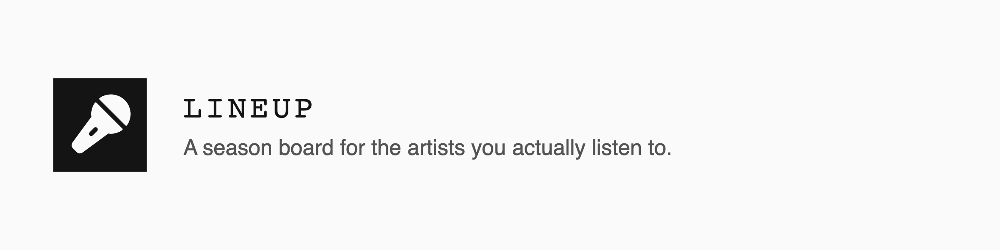

<!-- messer:hero — generated by `python3 ~/Repos/messer-projects/scripts/publish.py --repo . --assets` -->
<picture>
  <source media="(prefers-color-scheme: dark)" srcset="docs/brand/banner-dark.png">
  
</picture>

**A season board for the artists you actually listen to.**

`MIT` · `Go` · `SQLite` · `pre-release`
<!-- /messer:hero -->

Lineup has no account. Your taste comes from a music service you already use, or from a list you paste;
the board itself is public, and a fresh visitor still gets the town board.

## Run

```bash
make build     # bin/lineup
make check     # gofmt + vet + tests + the public-tree scan
./bin/lineup version
```

`lineup mine` walks event platforms country by country and writes the index; `lineup verify` checks the
publication rules before anything leaves the machine; `lineup serve` serves the same index locally, for
self-host. Mining never happens in the board's runtime.

## What it does

|  |  |
|---|---|
| **Artists you actually listen to** | imported from a music service, or a list you paste |
| **Rooms near a point you choose** | distance in kilometres on the row, not a map you have to read |
| **A date window** | the season you are planning, not everything ever announced |
| **Ticket link** | every row links out to the seller; the board never pretends to sell |
| **No account** | the board is public; the taste is local |

## How it works

One private miner walks event platforms country by country and writes a published **index** — a
manifest, a town list and one content-addressed shard per town. The index is static files, so serving
it costs nothing and there is no database in the read path. Only the *mined* projection is published:
nine keys per show, no prices, no descriptions, no images, every row linking out to the seller.

```
lineup mine   →  index/{manifest.json, towns.json, towns/<town>-<sha256>.jsonl.gz}
lineup verify →  the publication rules, checked before anything leaves the machine
lineup serve  →  the same index, locally, for self-host
```

The board is a React app served beside a small API; mining never happens there.

| Path | What |
|---|---|
| `cmd/lineup/` | the one binary: miner, publisher, local server |
| `internal/` | model (rows, identity), fetch, sources, board selection, index writer |
| `sources/` | the source registry — data only, one file per country |
| `web/` | the board (React), built to `web/dist` and served as static assets |
| `internal/model/testdata/keys.json` | the identity contract: 30 vectors both runtimes must agree on |

## Agents

Read [`AGENTS.md`](AGENTS.md) — the code contract. The primer is [`docs/llms.txt`](docs/llms.txt).
`make check` is the gate, and it includes the public-tree scan: this repository is mined source, and a
leak of a private key path or a price would be a product failure, not a documentation one.

Contributions are closed. Issues are for takedown requests and data corrections — see
[`CONTRIBUTING.md`](CONTRIBUTING.md). A vulnerability goes to a private advisory, per
[`SECURITY.md`](SECURITY.md).

## Design notes

**Identity.** A show's key is `artistKey|venueKey|date`. Names are normalised the same way in Go and in
TypeScript, and the vector file is the contract — an implementation that disagrees with it is wrong, and
the vectors are never edited to make a test pass.

**Publication.** Only a thin projection is published, and a test proves a full-fidelity show cannot leak
a price or an image into it. The published window is 120 days, every row links out, and robots and
takedown requests are honoured. The index is an advertisement, never an archive.

**Two runtimes, one contract.** Serving happens on an edge network; the miner runs on the machine that
owns the crawl. Both read the same index files, and the parts that must agree are held to one fixture
file rather than to prose.

## Status

**P0.** The skeleton, the identity contract, the fetch profile and the first source adapters are being
built; `lineup` currently answers `version` only. `docs/coverage.md` carries the measured state of each
source as it lands.

## License

MIT — including the miners and the index format. Not accepting contributions; see
[`CONTRIBUTING.md`](CONTRIBUTING.md).
